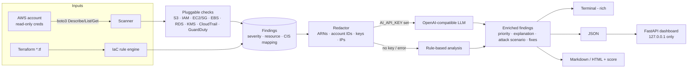

# AI-Powered Cloud Security Engine

AI-powered cloud security engine: scans AWS for misconfigurations and uses AI to prioritize and explain fixes.

- **Read-only AWS scanner** (boto3, standard credential chain) with pluggable checks mapped to CIS AWS Foundations / AWS Foundational Security Best Practices.
- **Terraform IaC scanning** with simple rule-based checks — shift-left before you deploy.
- **AI analysis** through any OpenAI-compatible API: risk prioritization, plain-English explanation, attack scenario, remediation steps, AWS CLI + Terraform fix snippets. Account IDs, ARNs, access keys, IPs and secrets are **redacted** before anything leaves your machine. Without an API key it falls back to a rule-based report.
- **Reports**: rich terminal table, JSON, Markdown and HTML with a 0–100 security score; optional local FastAPI dashboard.

## Architecture



## Checks

| ID | Service | Check | Mapping |
|---|---|---|---|
| S3.1 | S3 | Block Public Access not fully enabled | CIS 2.1.4, FSBP S3.8 |
| S3.2 | S3 | Public ACL grant (AllUsers/AuthenticatedUsers) | FSBP S3.2 |
| S3.3 | S3 | No default encryption | CIS 2.1.1, FSBP S3.4 |
| S3.4 | S3 | Versioning disabled | FSBP S3.14 |
| IAM.1 / IAM.2 | IAM | Root MFA disabled / root access keys | CIS 1.5 / 1.4 |
| IAM.3 | IAM | Console user without MFA | CIS 1.10 |
| IAM.4 | IAM | Access key older than 90 days | CIS 1.14 |
| IAM.5 | IAM | Customer policy with `*:*` | CIS 1.16 |
| EC2.1 | EC2 | SG open to 0.0.0.0/0 or ::/0 on SSH/RDP/DB ports | CIS 5.2/5.3 |
| EC2.2 | EC2 | IMDSv1 allowed | CIS 5.6, FSBP EC2.8 |
| EBS.1 / EBS.2 | EC2 | Encryption-by-default off / unencrypted volume | CIS 2.2.1 |
| RDS.1 / RDS.2 | RDS | Unencrypted / publicly accessible | CIS 2.3.1 / 2.3.3 |
| KMS.1 | KMS | CMK rotation disabled | CIS 3.6 |
| CT.1 / CT.2 | CloudTrail | No active trail / no log validation | CIS 3.1 / 3.2 |
| GD.1 | GuardDuty | Not enabled | FSBP GuardDuty.1 |

Terraform rules (`TF.*`) cover public S3 ACLs, missing encryption / public-access-block, open SGs, unencrypted/public RDS, unencrypted EBS, IMDSv1, KMS rotation, wildcard IAM policies and CloudTrail log validation.

Adding a check: create a function in `cloudsec/checks/` decorated with `@check("MY_ID", "service", regional=True)` that yields `Finding` objects.

## Setup

```bash
git clone https://github.com/shubhamkhedkar/ai-powered-cloud-security-engine
cd ai-powered-cloud-security-engine
python -m venv .venv && source .venv/bin/activate
pip install -e ".[dashboard]"
```

Grant the scanning identity the minimal read-only policy in [`iam-policy.json`](iam-policy.json) (or the AWS-managed `SecurityAudit` policy). The tool only issues Describe/List/Get calls.

Optional AI configuration:

```bash
export AI_API_KEY=sk-...                         # enables AI analysis
export AI_BASE_URL=https://api.openai.com/v1     # any OpenAI-compatible endpoint
export AI_MODEL=gpt-4o-mini
```

## Usage

```bash
# Scan AWS (default region ap-south-1)
cloudsec aws --profile audit --markdown report.md --html report.html --json report.json

# All enabled regions, specific services, CI gate
cloudsec aws --all-regions --services s3,iam,ec2 --fail-on HIGH

# Terraform
cloudsec iac ./infra --no-ai --min-severity MEDIUM

# Local dashboard (binds to 127.0.0.1)
cloudsec dashboard report.json --port 8000

# Docker
docker build -t cloudsec .
docker run --rm -v ~/.aws:/home/scanner/.aws:ro -e AWS_PROFILE=audit cloudsec aws --all-regions
```

Exit code is `2` when `--fail-on` threshold is hit.

## Sample report

Generated with `cloudsec iac examples/terraform --no-ai --markdown examples/sample-report.md` — see [`examples/sample-report.md`](examples/sample-report.md). Excerpt:

```text
Security score: 36/100  (mode=iac, analysis=rules)
1. [CRITICAL] S3 bucket uses public ACL      examples/terraform/insecure.tf:1 aws_s3_bucket.data
2. [CRITICAL] RDS publicly accessible        examples/terraform/insecure.tf:16 aws_db_instance.db
3. [HIGH]     Security group open to the internet on sensitive port ...
```

With AI enabled each finding additionally gets a risk score, attack scenario and ready-to-review `aws` CLI / Terraform fix snippets.

## Testing

```bash
pip install -r requirements-dev.txt
ruff check . && pytest -q
```

Tests use [moto](https://github.com/getmoto/moto) to emulate AWS and a mocked HTTP transport for the AI layer — no real cloud or API calls.

## Privacy & safety

- Read-only: no write/modify API calls are ever made.
- Redaction of ARNs, 12-digit account IDs, access key IDs, secret-like strings, resource IDs and IPs before any AI request.
- AI output is advisory — review every fix snippet before applying it.

## Limitations

- Terraform scanning is regex/heuristic, not a full HCL parser (no module/variable resolution).
- Bucket policies, Organizations SCPs, and many services (Lambda, EKS, CloudFront…) are not yet covered.
- S3 Block Public Access is checked per bucket, not at the account level.

## License

MIT
